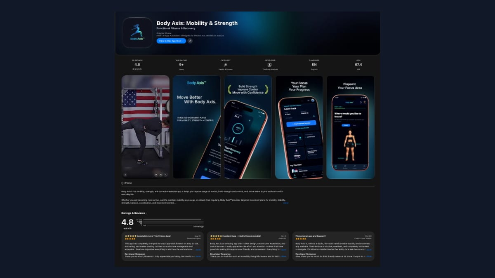
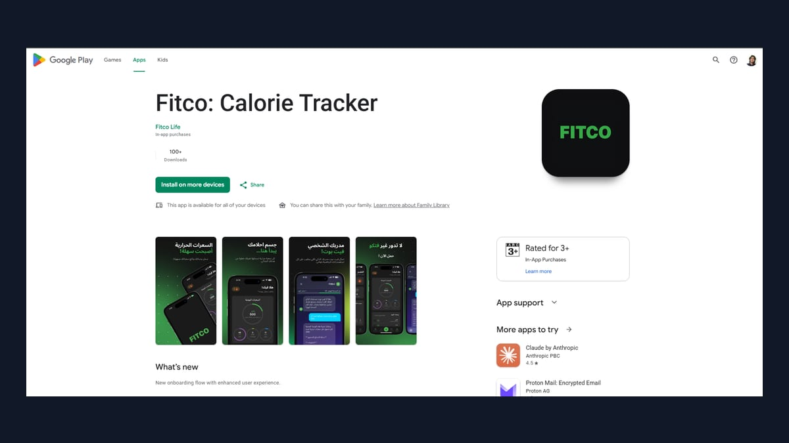
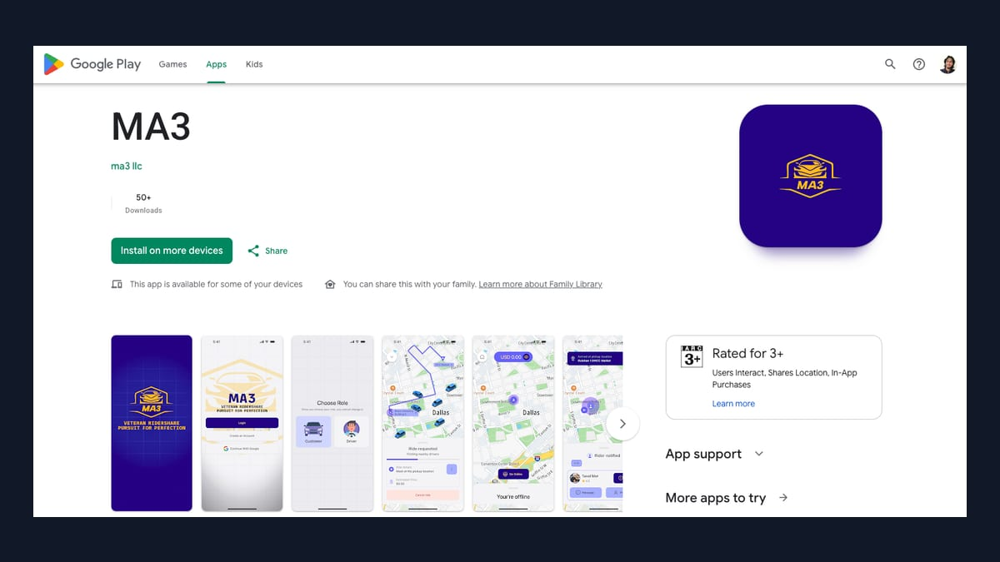
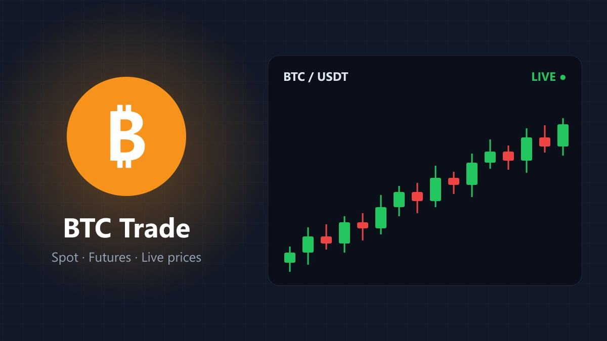
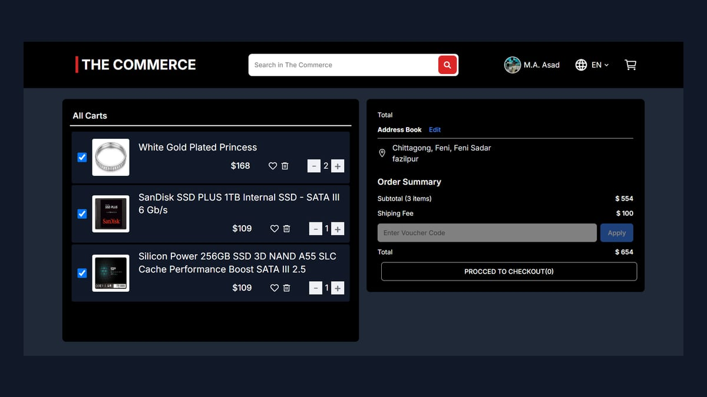
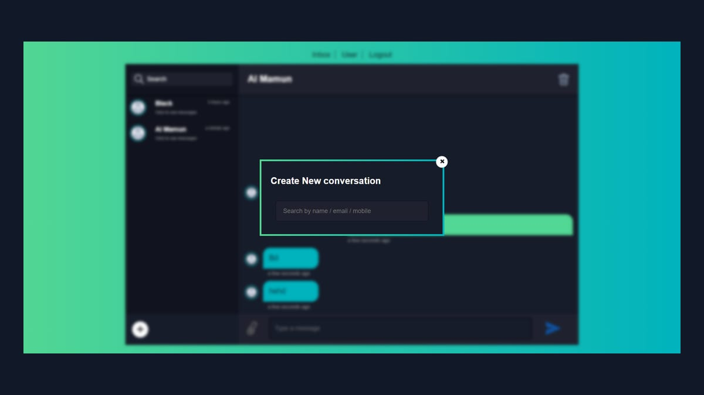
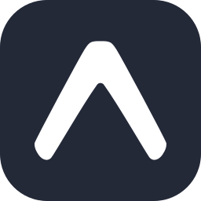

## 🚀 Projects

<table>
<tr>
<td width="33%" valign="top" align="center">
 

<h4>Body Axis</h4>
Full-stack fitness app · solo build  

  
</td>
<td width="33%" valign="top" align="center">
 

<h4>Fitco</h4>
Arabic & English calorie tracker  

  
</td>
<td width="33%" valign="top" align="center">
 

<h4>MA3</h4>
Ride sharing · live maps · payments  

  
</td>
</tr>
<tr>
<td width="33%" valign="top" align="center">
 

<h4>BTC Trade</h4>
Bitcoin spot & futures trading  

  
</td>
<td width="33%" valign="top" align="center">
 

<h4>The Commerce</h4>
Full-stack e-commerce store  

  
</td>
<td width="33%" valign="top" align="center">
 

<h4>Express Chat App</h4>
Real-time chat rooms with Socket.IO  

  
</td>
</tr>
</table>

## Education & achievements

<table>
<tr>
<th width="50%">🎓 Education</th>
<th width="50%">🏆 Achievements</th>
</tr>
<tr>
<td valign="top">
 
<b><a href="https://mohammad-al-asad.vercel.app/educations/9181606f-29d4-484d-873e-756566e29231">Diploma in Engineering, Computer Science & Technology</a></b> 
Feni Govt. Polytechnic Institute · 2021–2026 · CGPA 3.61
  
<b><a href="https://mohammad-al-asad.vercel.app/educations/376c99cb-cbfa-49fe-b94f-7b33e3618d7c">Secondary School Certificate (SSC)</a></b> 
Fazilpur High School · 2016–2021 · GPA 4.78
  
</td>
<td valign="top">
 
<b><a href="https://mohammad-al-asad.vercel.app/achievements/77e6e594-61d1-489a-97ef-13e7101e410c">IELTS Academic: Band 6.5 (CEFR B2)</a></b> 
British Council, IDP IELTS & Cambridge English · 2026
  
<b><a href="https://mohammad-al-asad.vercel.app/achievements/444761ee-6665-468f-964f-c407b691d7a0">🥈 2nd place, Skills Competition 2025</a></b> 
Computer Department · Feni Polytechnic Institute, ASSET Project · 2025
  
</td>
</tr>
</table>

## 🧰 Toolbox

<table>
<tr><td><b>Mobile</b></td><td> </td></tr>
<tr><td><b>Frontend</b></td><td></td></tr>
<tr><td><b>Backend</b></td><td></td></tr>
<tr><td><b>Data</b></td><td></td></tr>
<tr><td><b>Cloud & DevOps</b></td><td></td></tr>
<tr><td><b>Also</b></td><td></td></tr>
<tr><td><b>In production</b></td><td>

</td></tr>
</table>

 

<i>If I die, I die — but if I live, I'll strive to fulfill the purpose my Creator has destined for me.</i>

