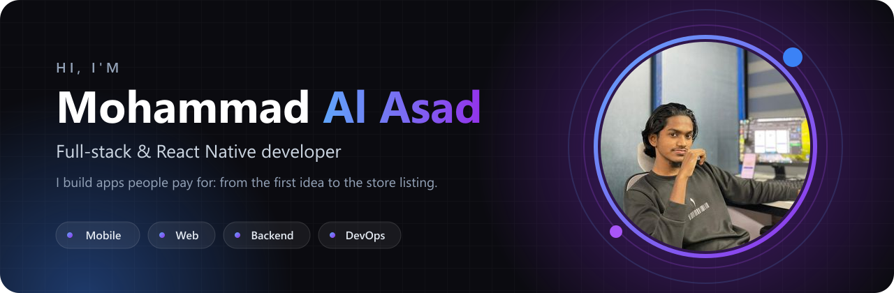
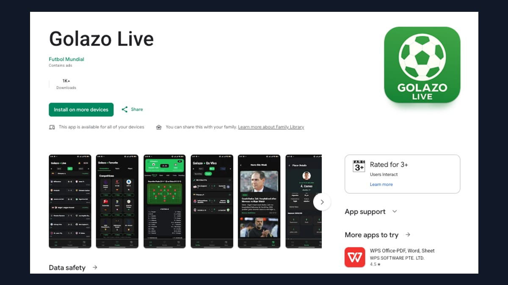

<div align="center">

<a href="https://mohammad-al-asad.vercel.app">
  
</a>

<br />

[](https://mohammad-al-asad.vercel.app)
[](https://www.linkedin.com/in/mohammad-al-asad)
[](https://x.com/maasad11914)
[](https://leetcode.com/u/maasad11914/)

</div>

---

## 👋 Hi, I'm Asad

I'm a **full-stack and React Native developer** and **CSE student from Bangladesh**. I build mobile and web products end to end: backend, admin dashboard, mobile app, deployment, and CI/CD. Then I keep them running for real users.

```ts
const asad = {
  role: "Full-stack & React Native developer",
  basedIn: "Bangladesh 🇧🇩",
  ships: ["iOS", "Android", "Web", "APIs"],
  focus: ["React Native · Expo", "Next.js", "Node · NestJS · FastAPI", "MongoDB · Prisma"],
  learning: ["System design", "DSA in C++"],
  openTo: "Freelance & full-time roles",
};
```

---

## 📱 Live on the stores

<table>
<tr>
<td width="50%" valign="top">

<a href="https://github.com/mohammad-al-asad/Body-Axis"></a>

### Body Axis: Mobility & Strength
A full-stack fitness platform I built **solo**: React Native app, FastAPI backend, React admin dashboard, Docker on AWS with CI/CD.

**$7.5k+ revenue · 2,800+ customers · 4.8 ★**

[App Store](https://apps.apple.com/us/app/body-axis-mobility-strength/id6761671211) · [Google Play](https://play.google.com/store/apps/details?id=com.jointhebodyinstitute.bodyaxis) · [Code](https://github.com/mohammad-al-asad/Body-Axis)

</td>
<td width="50%" valign="top">

<a href="https://github.com/mohammad-al-asad/Fitco-Calorie-Tracker"></a>

### Fitco: Calorie Tracker
A bilingual (Arabic & English) nutrition app with full right-to-left support, RevenueCat subscriptions, Superwall paywalls, and AppsFlyer attribution.

**Arabic & English · RTL · Subscriptions**

[App Store](https://apps.apple.com/us/app/%D9%81%D8%AA%D9%83%D9%88-%D8%AD%D8%B3%D8%A7%D8%A8-%D8%A7%D9%84%D8%B3%D8%B9%D8%B1%D8%A7%D8%AA/id6755593832) · [Google Play](https://play.google.com/store/apps/details?id=com.fitcoksa) · [Code](https://github.com/mohammad-al-asad/Fitco-Calorie-Tracker)

</td>
</tr>
<tr>
<td width="50%" valign="top">

<a href="https://github.com/mohammad-al-asad/MA3-Ride-Sharing-App"></a>

### MA3: Ride Sharing
Rider and driver apps in one codebase: live GPS tracking, real-time chat over Socket.IO, and Stripe payments with driver payouts.

**Maps · Real-time · Payments**

[App Store](https://apps.apple.com/us/app/ma3/id6762648482) · [Google Play](https://play.google.com/store/apps/details?id=co.ma3llc) · [Code](https://github.com/mohammad-al-asad/MA3-Ride-Sharing-App)

</td>
<td width="50%" valign="top">

<a href="https://github.com/mohammad-al-asad/Golazo-Live"></a>

### Golazo Live: Live Scores & News
Live football scores, lineups, stats, and news from 25 competitions, with over-the-air updates and AdMob monetisation.

**1K+ downloads · Live data · OTA updates**

[App Store](https://apps.apple.com/us/app/golazo-live/id6753016723) · [Google Play](https://play.google.com/store/apps/details?id=com.golazo.live) · [Code](https://github.com/mohammad-al-asad/Golazo-Live)

</td>
</tr>
</table>

### 🌐 On the web

| Project | What it is |
| --- | --- |
| [**The Portfolio**](https://github.com/mohammad-al-asad/The-Portfolio) | My portfolio with its own admin panel: Next.js 15, Prisma, MongoDB, instant cache refresh · [live](https://mohammad-al-asad.vercel.app) |
| [**Certificate Generator**](https://github.com/mohammad-al-asad/Certificate-Generator) | Generate, share, and download certificates with QR-code access · [live](https://certificate-generator-gamma-blond.vercel.app) |
| [**The Commerce**](https://github.com/mohammad-al-asad/The-Commerce) | Full-stack e-commerce store with cart, checkout, and order management · [live](https://the-commerce-ten.vercel.app) |
| [**Express Chat App**](https://github.com/mohammad-al-asad/Express-Chat-App) | Real-time chat rooms with Socket.IO, JWT sessions, and file uploads · [live](https://express-chat-app-pi.vercel.app) |

---

## 🧰 Toolbox

<table>
<tr><td><b>Mobile</b></td><td> </td></tr>
<tr><td><b>Frontend</b></td><td></td></tr>
<tr><td><b>Backend</b></td><td></td></tr>
<tr><td><b>Data</b></td><td></td></tr>
<tr><td><b>Cloud & DevOps</b></td><td></td></tr>
<tr><td><b>Also</b></td><td></td></tr>
</table>

**In production:** RevenueCat · Superwall · AppsFlyer · Stripe · Socket.IO · Google AdMob · EAS Build & Update · Resend · Sentry

---

## 🔁 How I ship

```text
idea ─▶ design ─▶ build (app · API · dashboard) ─▶ CI/CD ─▶ App Store & Google Play
                                                              │
                     ◀── fix · improve · release safely ◀─────┘  real users
```

I don't stop at launch. I track down bugs real users hit, fix them, and release new versions without breaking anyone still on an older one.

---

<div align="center">

### Have an idea? Let's build it.

[](https://mohammad-al-asad.vercel.app/#contact)
[](https://www.facebook.com/maasad11914)
[](https://www.instagram.com/maasad11914)

<br />

> *If I die, I die — but if I live, I'll strive to fulfill the purpose my Creator has destined for me.*

</div>
